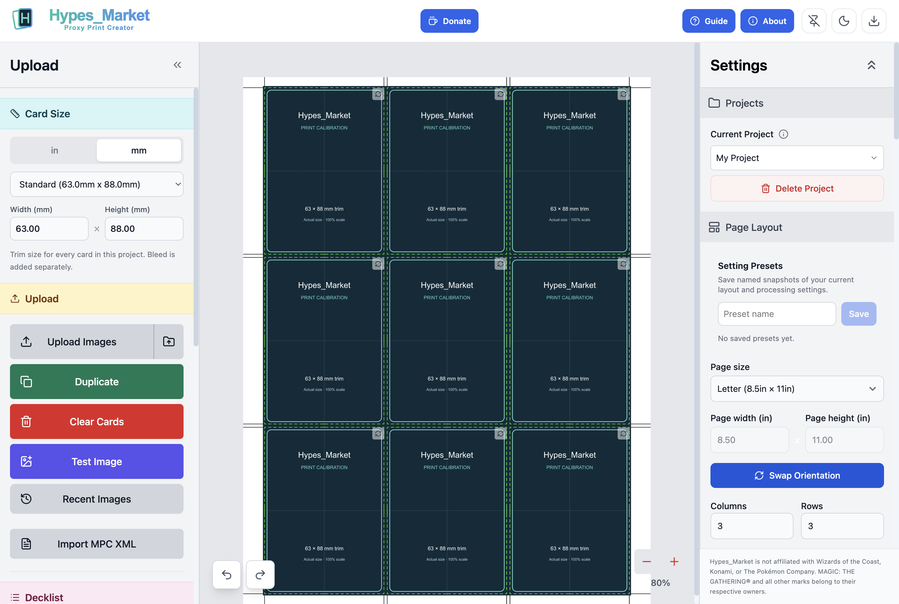
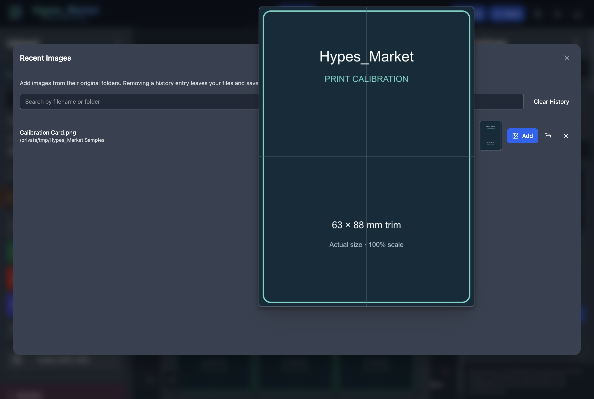

# Hypes_Market Proxy Print Creator

**Spend more time playing and less time preparing your print sheets.**

A free desktop app for arranging card images and exporting print-ready PDFs on **Apple Silicon Macs** and **Windows 11**.

**No ads. No subscriptions. No telemetry. Every feature is available without donating.**

## Download version 1.0.22

| Your computer | Download |
| --- | --- |
| Mac with Apple Silicon (M-series) | [Download for Mac](https://github.com/HypesMarket/Hypes_Market-Proxy-Print-Creator/releases/download/v1.0.22/Hypes_Market-1.0.22-mac-arm64.zip) |
| Windows 11, x64 | [Download for Windows](https://github.com/HypesMarket/Hypes_Market-Proxy-Print-Creator/releases/download/v1.0.22/Hypes_Market-1.0.22-win-x64.zip) |

[Latest release](https://github.com/HypesMarket/Hypes_Market-Proxy-Print-Creator/releases/latest) · [Installation guide](INSTALLATION.md) · [What's changed](CHANGELOG.md)

No developer tools needed. Intel Macs are unsupported. The Mac app is ad-hoc signed and not notarized; Windows builds are unsigned portable ZIPs. Choose the named app ZIP. GitHub's automatic **Source code** archives contain documentation, not the app.

## New in version 1.0.22

**Recent Images** now shows an enlarged preview when you hover over a thumbnail. Move your pointer away to close it. Since v1.0.20, this panel remembers the original file locations for images you add to the sheet. Version 1.0.21 added thumbnails beside those locations.

## Features

- **Print-ready layouts:** fronts, backs, duplex and interleaved PDFs, card image exports, and cutting templates.
- **Flexible sizing:** 20 named card sizes plus custom dimensions, with millimeter and inch controls.
- **Precise settings:** page sizes, grids, spacing, bleed, positioning, and cutting guides, with saved projects and presets.
- **Easy uploads:** choose images or drag files from Finder or File Explorer onto the sheet. Existing cards stay in place.
- **Recent Images** remembers your source files and lets you add them to another sheet. Removing an entry or clearing the list leaves the original files and saved sheets in place.
- **Recent PDF downloads:** the button beside the theme control remembers the last 20 completed PDFs on this device. A green dot marks new saves; click a PDF to show its folder.
- **Everyday tools:** Duplicate, an offline calibration card, Undo/Redo, light/dark modes, zoom, a window pin, and an offline Guide.
- **Import options:** images, decklists, online artwork sources, and MPC Autofill XML.

## Quick start

1. Extract and open the app using the [installation guide](INSTALLATION.md).
2. Upload or drop images onto the sheet, or click **Test Image**.
3. Choose a card size and layout, then configure bleed, guides, and upscaling.
4. Export and print at **100% / Actual Size**, with printer scaling disabled. Measure a test sheet first. Use **Standard (63 × 88 mm)** for the calibration card's size label.

Open **Guide** for the full workflow. Screen zoom does not change printed dimensions.

## Image quality

At a **1400 DPI minimum**, Bicubic/Lanczos enlarge 300 DPI artwork directly to 1400, keep 1400 DPI artwork at 1400, and retain 1800 DPI artwork at 1800. **No upscaling** uses the lower of the source resolution and your selected DPI ceiling. Processing runs locally during export; previews are separate and original files remain unchanged. Enlargement cannot recreate missing detail.

Higher-resolution output may need more memory and create larger files. Lowering the Bicubic/Lanczos minimum does not reduce sources already above it. See [large-export guidance](INSTALLATION.md#large-exports) if a resource check reports a problem.

Configure source bleed manually in the right Settings column. To retain transparent PNG corners, use **0 mm output bleed** or **No Bleed** and check per-card overrides. Positive generated bleed fills a square margin. Cutting-guide shapes do not change transparency.

## Screenshots

Hypes_Market v1.0.22 on an Apple Silicon Mac. Both screenshots use the built-in geometric calibration card. Click an image to view it at full size.

## Privacy and support

Projects, images, settings, and file histories stay on your computer. Image editing and PDF generation run locally. Optional online features contact external services; card catalog requests may also run automatically. Plain uploads do not automatically send filenames for card lookups.

[Report an issue](https://github.com/HypesMarket/Hypes_Market-Proxy-Print-Creator/issues) or email [support@hypesmarket.com](mailto:support@hypesmarket.com). Include your version, operating system, and reproduction steps. Only share files you are comfortable making public.

Support development: [**Buy Me a Coffee**](https://buymeacoffee.com/hypesmarket) · [**Ko-fi**](https://ko-fi.com/hypesmarket). Donations are optional. Payment and privacy policies belong to those sites.

## Release and rights

This repository provides official downloads and documentation. [SHA256SUMS.txt](SHA256SUMS.txt) lists v1.0.22 app checksums. Updates are manual.

The hover preview was checked on Mac. The Windows package was inspected. Windows 11 runtime testing is pending for v1.0.22.

Hypes_Market uses MIT licensing; adapted code and dependencies retain their own rights and licenses. See [THIRD_PARTY_NOTICES.md](THIRD_PARTY_NOTICES.md). Software licensing does not grant artwork rights; use artwork you have permission to reproduce.

Hypes_Market is not affiliated with Wizards of the Coast, Konami, or The Pokémon Company. MAGIC: THE GATHERING® and all other marks belong to their respective owners.
