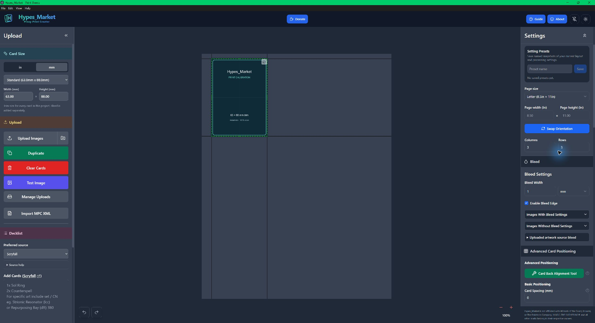
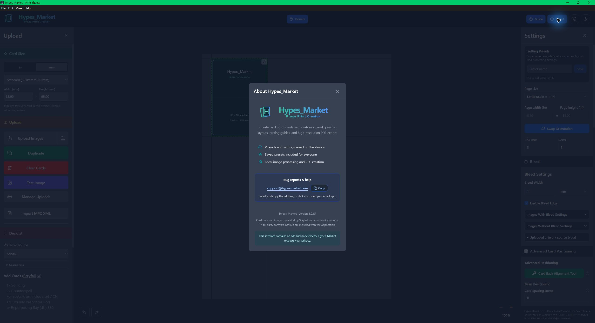

# Hypes_Market Proxy Print Creator

**Spend more time playing and less time preparing your print sheets.**

A free desktop app for arranging card images and exporting print-ready PDFs. Built for proxy playtesting, custom artwork, and casual card projects on **Apple Silicon Macs** and **Windows 11**.

**No ads. No subscriptions. No telemetry. Every feature is available without donating.**

## Download version 1.0.16

| Your computer | Download | Status |
| --- | --- | --- |
| Mac with Apple Silicon (M-series) | [Download for Mac](https://github.com/HypesMarket/Hypes_Market-Proxy-Print-Creator/releases/download/v1.0.16/Hypes_Market-1.0.16-mac-arm64.zip) | Tested on Apple Silicon macOS |
| Windows 11, x64 | [Download for Windows](https://github.com/HypesMarket/Hypes_Market-Proxy-Print-Creator/releases/download/v1.0.16/Hypes_Market-1.0.16-win-x64.zip) | Unsigned build; see the Windows 11 validation history below. |

### Windows 11 validation (November 3, 2026)

Version 1.0.15 passed focused Windows 11 checks for calibration-card rendering, duplication, Ctrl+Z, and saving a 1400 DPI Lanczos fronts-only PDF through the native Save dialog. The exported Letter page, artwork resolution, physical placement including bleed, and independent PDF rendering were verified. The user also tested physical printing on Windows 11 and confirmed it works as intended.

These checks do not cover every export mode or printer configuration; duplex printing and broader Windows regression testing were not separately verified.

Version 1.0.16 passed the focused release checks described in its release notes, including the PNG and download-history regressions. It was not separately runtime-tested on a Windows device during this release preparation; the Windows 11 checks above apply to version 1.0.15.

[Latest release and all download files](https://github.com/HypesMarket/Hypes_Market-Proxy-Print-Creator/releases/latest) · [Installation guide](INSTALLATION.md) · [What's changed](CHANGELOG.md)

No Node.js or developer tools are needed. Mac builds target Apple Silicon; Intel Macs are not supported. The Mac app is ad-hoc signed and not notarized. The Windows download is a portable ZIP, not an installer.

Choose the named Mac or Windows ZIP. GitHub's automatically generated **Source code** archives contain this download repository's documentation, not the runnable app.

## New in version 1.0.16

- **Fixed invisible PNGs:** mostly translucent artwork now stays visible when generated bleed is enabled, in previews and PDF exports. Saved previews refresh automatically from original artwork, and original image files remain unchanged.
- **Drag-and-drop uploads:** drag one or more images from Finder or File Explorer onto the sheet to fill the next available tiles. Existing cards remain in place, and dropped files use the same local upload workflow and manual bleed settings as Upload Images.
- **Recent PDF downloads:** the download button immediately to the right of the theme button remembers the last 20 completed PDFs on this device. A green dot marks new saves; click a PDF to show it in its folder.
- **Updated Guide:** offline instructions cover dropping images onto the sheet and finding saved PDFs.

## Screenshots

Hypes_Market 1.0.15 running on Windows 11. Click either image to view it at full size.

### Main app

The workspace with the bundled calibration card, card-size controls, and page layout settings.

### About Hypes_Market

The About panel with the application version, local-processing information, support contact, and privacy statement.

## Make your next print project easier

- **Print-ready PDFs:** arrange fronts and backs, choose duplex or interleaved output, and export cutting templates.
- **Flexible card sizes:** 20 named sizes plus custom dimensions, with millimeter and inch controls.
- **Precise layouts:** page sizes, rows, columns, spacing, bleed, positioning, and cutting guides.
- **Free saved presets and projects:** keep reusable settings and separate card projects on your computer.
- **Local upscaling:** Lanczos and **1400 DPI** are the factory defaults. No upscaling and Bicubic are also available. Higher custom DPI values depend on your computer's resources; enlargement cannot recreate missing image detail. Saved upscaling choices are preserved.
- **Simple uploads and manual bleed:** drag image files onto the sheet, or use the plain Upload Images button and its desktop parent-folder shortcut. Manage Uploads opens your image library. Configure source and output bleed in the right Settings column.
- **Transparent artwork:** rounded PNG corners and partial transparency are preserved when no new bleed is generated; saved previews refresh from their original artwork. Positive generated bleed intentionally fills a square print margin.
- **Fast card actions:** Duplicate copies the last card on the current sheet, including artwork, edits, and its linked back. Test Image adds an offline calibration card. Clear Cards asks for confirmation.
- **Comfortable viewing:** light and dark modes, an offline Guide, always-visible red −/+ zoom symbols with a clear hover/focus background and the percentage underneath, and a pin button to keep the app above other ordinary windows.
- **More ways to import:** upload your images, enter a decklist, use supported online artwork sources, or import MPC Autofill XML.

## Quick start

1. Extract and open the app using the [installation guide](INSTALLATION.md).
2. Upload card images, drag image files onto the sheet, or click **Test Image** for the bundled calibration artwork.
3. Select a card size and adjust the page layout. The factory layout is Letter paper with a 3 × 3 grid; larger cards may need fewer rows or columns.
4. Configure bleed manually in the right column, then choose cutting guides and upscaling. New projects use your saved personal defaults when available.
5. Export your PDF, then print at **100% / Actual Size**, with printer scaling disabled. Measure a test sheet before printing a full deck. Use **Standard (63 × 88 mm)** when checking the calibration card's printed size label.

Open **Guide** inside the app for the full workflow. Screen zoom changes your view, not the printed size.

### Upload folders and manual bleed

On desktop, **Upload Images** remembers the last folder from which you confirmed an upload. The folder-up button beside it opens that folder's parent, making neighbouring card folders easier to reach. Choose images once before using this shortcut. On Mac, **Command + Up Arrow** also goes to the enclosing folder inside the picker; Back/Forward history starts fresh when the picker reopens.

New uploads start with **no built-in source bleed**. They are not classified automatically from their dimensions. If artwork already contains a margin, select an uploaded front card and open **Bleed → Uploaded artwork source bleed** on the right. Set **Artwork already includes bleed**, enter the source amount in millimeters, and choose **Apply to all copies in this project**. This changes all copies of the selected artwork in the open project, including linked backs using the same artwork. Saved library records and other projects stay unchanged, and keyboard Undo/Redo is available.

**Bleed Width** and **Images With/Without Bleed Settings** control the output margin. To retain transparent rounded corners, use **0 mm output bleed** or the appropriate **No Bleed** option, and check per-card overrides. Square/Round cutting guides change cut marks, not image transparency.

### Card arrows and keyboard history

The lower-left **back arrow removes the most recently added card and its linked back**. It leaves your settings unchanged. Addition order is separate from tile arrangement; older cards without addition history use their saved sheet order as the starting removal order.

The **right curved arrow duplicates the last front card by current sheet order** into the next tile. **Cmd/Ctrl + Z** and **Cmd/Ctrl + Shift + Z** remain Undo and Redo for history actions, including restoring removed cards and changing settings.

### Find recent PDFs

The **Recent PDF downloads** button immediately to the right of the theme button lists the last 20 completed PDFs saved by the app, newest first, with filenames, dates, and sizes. A green dot marks a newly saved PDF. Click a PDF to open its containing folder in Finder or File Explorer, with the file selected.

History stays on this device across restarts. Cancelled or failed downloads and PDFs saved before this feature was added are not listed. If a file was moved or deleted outside the app, a helpful message explains why it cannot be shown. App updates are still downloaded manually.

## Privacy

Projects, uploaded images, settings, presets, and recent PDF download history are stored on your computer. Uploaded-image editing and PDF generation run locally. Plain local uploads do not automatically send their filenames for card lookups.

The application contains **no ads or usage telemetry**. Optional searches, Identify, online artwork, and deck imports contact the selected external services; card catalog requests may also run automatically. Donation links open third-party websites in your browser. Their own privacy and payment policies apply, and the app does not collect payment details.

**Hypes_Market respects your privacy.**

## Support development

If Hypes_Market saves you time preparing a deck or printing custom art, a donation helps support bug fixes, better print quality, and features requested by the proxy community.

[**Buy Me a Coffee**](https://buymeacoffee.com/hypesmarket) · [**Support on Ko-fi**](https://ko-fi.com/hypesmarket)

Donations are completely optional. Every feature is available without donating. The centered **Donate** button in the app opens these same support options.

## Bug reports and help

[Open an issue](https://github.com/HypesMarket/Hypes_Market-Proxy-Print-Creator/issues) or email **[support@hypesmarket.com](mailto:support@hypesmarket.com)**.

Include your app version, operating system, what you expected, what happened, and steps to reproduce it. Attach screenshots or sample files only when you are comfortable sharing them publicly. Keep your original artwork and exported decklists as backups outside the app.

## Release and license information

This repository provides official application downloads and user documentation. Release ZIPs contain the standalone app and bundled dependency notices. [SHA256SUMS.txt](SHA256SUMS.txt) lists the two version 1.0.16 app download checksums. Updates are downloaded manually; this version has no automatic update service.

The Hypes_Market project uses MIT licensing, with adapted code and dependencies retaining their own rights, copyright notices, and licenses. Read [THIRD_PARTY_NOTICES.md](THIRD_PARTY_NOTICES.md) and the notices included with the app. Software licensing does not grant rights to third-party card artwork.

Hypes_Market is not affiliated with Wizards of the Coast, Konami, or The Pokémon Company. MAGIC: THE GATHERING® and all other marks belong to their respective owners.
